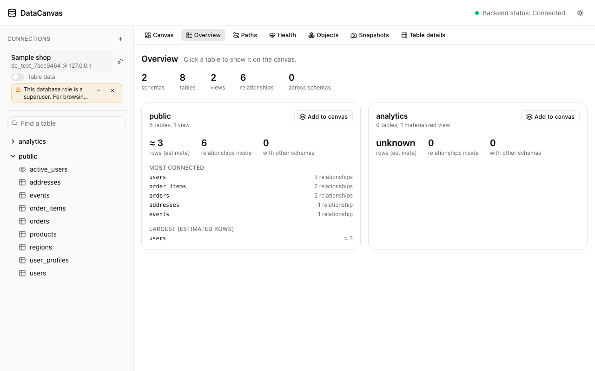
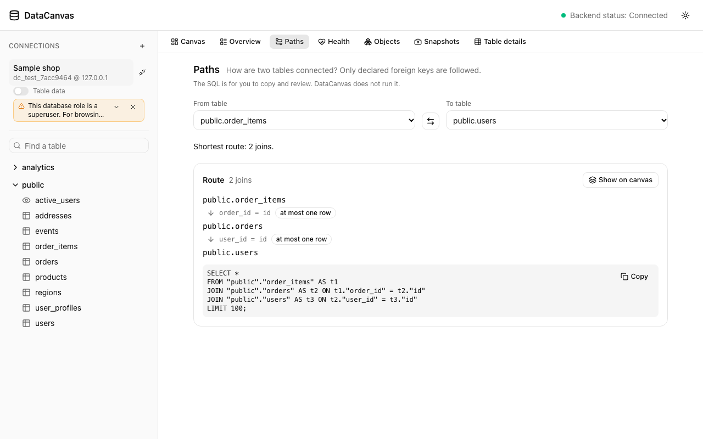
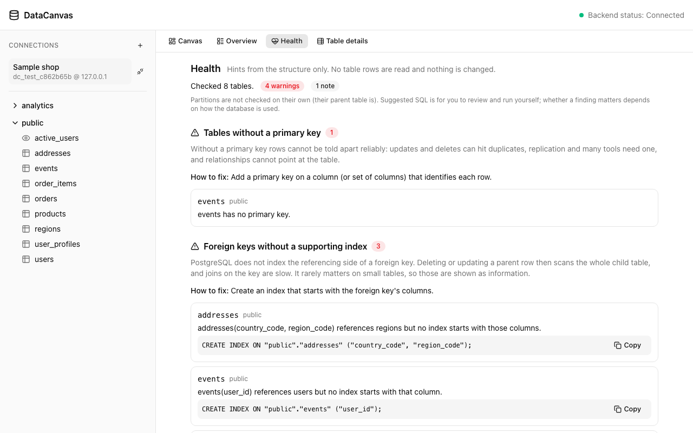
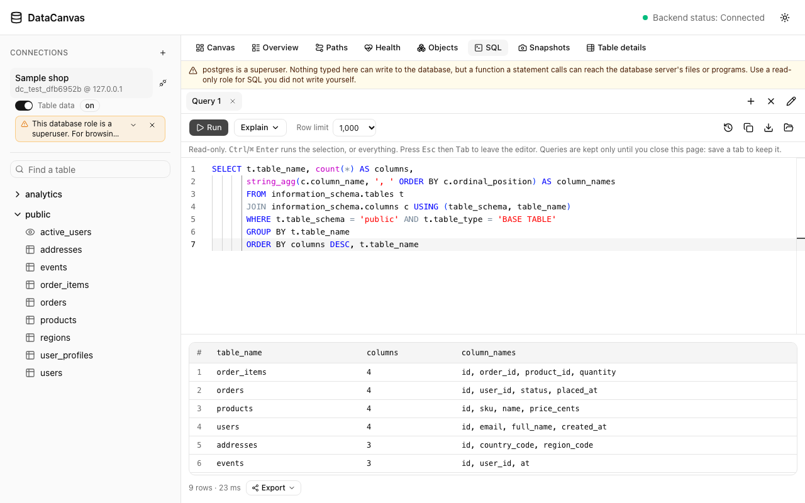
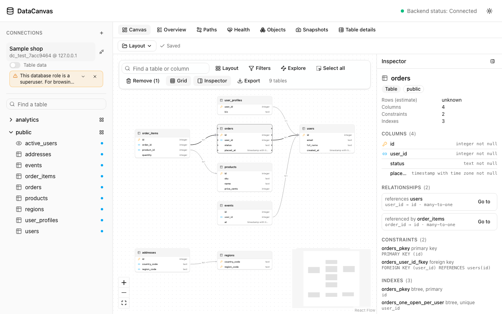
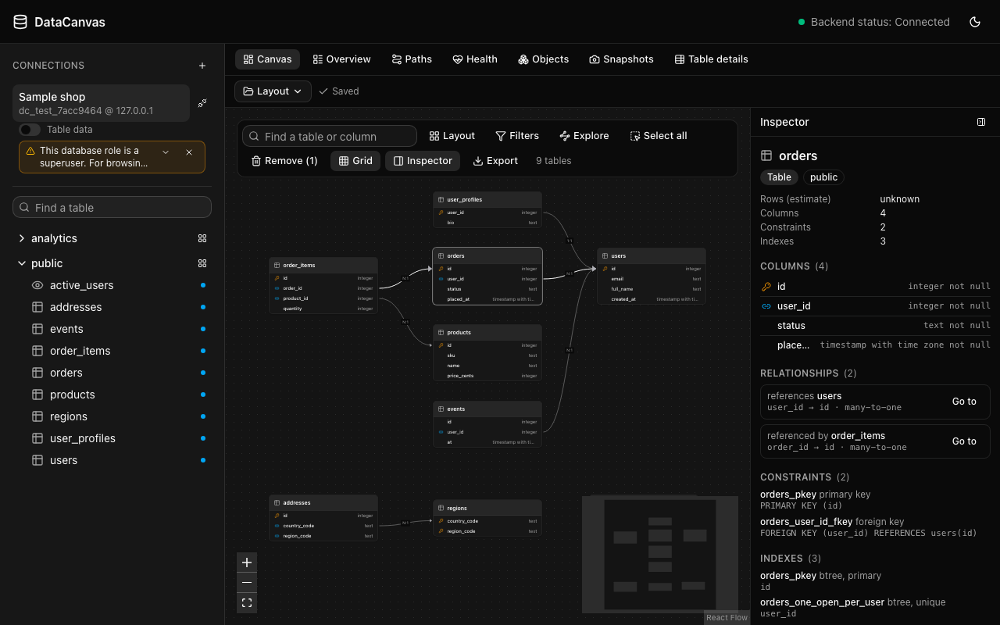

# DataCanvas

**See your PostgreSQL database as a map.** Connect, explore tables and relationships on an interactive canvas, and keep your layouts. It runs on your computer and nothing leaves it.

```bash
npx --yes @shubhamtiwari909/datacanvas
```

That is the whole installation. You only need [Node.js](https://nodejs.org) 20.9 or newer: no clone, no build, no `.env` file, no account. It prints a private link and opens your browser; press Ctrl+C to stop.

**Documentation:** [pg-visualizer-docs.vercel.app](https://pg-visualizer-docs.vercel.app/)













## What you can do

- **Connect** to PostgreSQL with a connection string or separate fields. Passwords are kept in memory only.
- **Get an overview** of the whole database: per schema, how many tables and views, how they connect to other schemas, the most connected tables, the largest tables and tables without relationships.
- **Find a path** between two tables: the shortest chain of foreign keys, the columns joined at each step, and a ready-to-copy `SELECT … JOIN …` (text to copy).
- **Check the model**: tables without a primary key, foreign keys without a supporting index, foreign keys whose column types differ, duplicate, redundant and unused indexes (from the server's own usage counters), optional (nullable) foreign keys, names that break the database's own style and very wide tables, each with an explanation and SQL you can copy.
- **See beyond tables**: view definitions and what each view reads, enums and other types, sequences, functions, triggers, extensions and row-level-security policies (definitions and settings only; this feature reads no table rows).
- **Snapshot and compare**: save the structure now, then compare it later with the live database, another snapshot or a different database. It lists added, removed and changed tables, columns, indexes, constraints, foreign keys and those objects, which is useful for drift and reviews. Snapshots hold structure only (no rows, no credentials, whether or not data viewing is on) and can be exported as files.
- **Document it**: **Export documentation** (the Overview tab, or the canvas export dialog) writes the structure of the database, or one schema, as a **Markdown data dictionary** or as a **Mermaid**, **DBML** or **PlantUML** diagram, made in your browser from names and types only (no row, no value).
- **Explore** schemas, tables, views, materialized views and foreign tables, with columns, keys, indexes, constraints and row-count estimates. **Find a table** by name from the top of the sidebar, across every schema. The details of a table also show its **statistics** from the server's own figures (how many values are NULL, how many differ, how wide, how big, when it was last vacuumed and analysed; read without touching a row).
- **Look at the rows** (optional, off by default): switch on **Allow viewing table data** for a connection and each table gets a Data section with its rows, one page at a time, read-only. You can **sort** by a column (click its header) and **filter** with up to ten conditions (equals, contains, ends with, a pattern, is one of a list, is between, the date shortcuts, JSON and array tests, is NULL), put in groups when any one of several is enough, or made from a cell with **Filter by this value**. Columns whose names look like secrets are not read unless you ask, NULL is told apart from an empty value, long values open in a dialog, and a **Blur values** switch helps when you share your screen. Rows, sorts and filter values are never saved, logged or put in a snapshot or workspace (the shape of each table's filter, its columns and operators, is kept in your browser). You can **export** the rows you are looking at (with the filter and sort on screen), or just the rows you chose, as CSV, TSV, JSON, NDJSON or a **script of INSERT statements** (one transaction, a cut script rolls itself back), up to 100,000 rows or 64 MB, edit a JSON value in a **JSON editor** with a tree and a comparison, and press **Validate** in the edit and add-row forms to ask the database whether it would accept the values, without writing a row (an event trigger in the database can still run during the check).
- **Edit rows and design tables** (optional, off unless you start DataCanvas with `--enable-writes`, and only for a database on your own machine): change, add and delete rows in the Data section (one at a time, or **chosen rows together**: set one value on up to 500 rows, or delete them, after a preview), **import a CSV file** of up to 100,000 rows (all of it or none of it), create tables from a form, and alter them (columns, keys, foreign keys, indexes, renames and drops). Every change is shown first as the exact statement that will run, runs in one transaction, and is refused rather than forced when something depends on it. Typing your own SQL is a separate, read-only feature (next).
- **Run SQL** (optional, read-only, needs **Allow viewing table data**): a **SQL** tab with an editor that highlights your statement and completes the names of your database's schemas, tables, columns and functions, several query tabs, a results grid, a history of what ran, **Explain** (as text, or as a **tree** with the rows the planner expected against the rows it got, the time of each step and what deserves the eye), and export of the rows as TSV, CSV or JSON. One statement at a time, in a read-only transaction on a connection of its own, with limits on rows and time; it cannot write, even with `--enable-writes`. Queries are kept only until you close the page, so save a tab as a `.sql` file to keep it.
- **Check a migration against your data** (optional, read-only, needs **Allow viewing table data**): in the Migrations tab, with a live database as _From_, **Check against the data** says how many rows would make a `SET NOT NULL`, a unique key, a foreign key or a required column fail, before you run the script. It does not check CHECK constraints or type changes, so the script is not fully verified against your data.
- **Write a migration** (optional, never run by DataCanvas): a **Migrations** tab compares two sides (a snapshot or the live database of any connection, so staging against production works) and writes the SQL that makes the first look like the second, **with its rollback**. Every step says what it risks (a lock, a rewrite, it can fail, it destroys data, it cannot be undone); you can leave a change out, confirm each destructive step (until then it is written commented out), and confirm the renames it suggests (a rename keeps the rows, a drop and an add does not). Tables, columns, keys, indexes, views, types, sequences, functions, triggers and policies are covered, in an order that runs. Export it as plain SQL, a dbmate or goose file, a Flyway pair, or `up.sql` and `down.sql`. It writes text and runs none of it.
- **See relationships** drawn as edges with their cardinality (1:1, 1:N, N:1), including across schemas.
- **Arrange** tables on an infinite canvas: drag, zoom, auto-layout (hierarchical, grouped, compact), search, filters, and focus on one table and its neighbours.
- **Save** layouts per connection; they are restored the next time you connect.
- **Export** a diagram as PNG or SVG, or a workspace as a file.
- **Light and dark themes**, or follow your system (button in the top bar).

## Your database, your machine, your control

- Everything runs locally and listens on `127.0.0.1` only.
- By default only **metadata** is read (names, types, keys, indexes). If you switch on **Allow viewing table data** for a connection, DataCanvas can also show the rows of a table you open: one page at a time, never saved, logged or put in a snapshot or workspace. Rows leave the page in a file you ask for with **Export**, which your browser saves on your computer (hidden columns are left out unless you showed them), and through the copy buttons of the cell dialog and the JSON editor, which put a value on your clipboard. SQL you type runs only in the **SQL** tab, read-only and one statement at a time (see [SECURITY.md](SECURITY.md)).
- DataCanvas **never changes your database unless you start it with `--enable-writes`**, the connection looks like one to a database on your own machine (an SSH tunnel to a remote database can look the same, see [SECURITY.md](SECURITY.md)), and you unlock writes for that connection by typing its name. Even then the SQL tab stays read-only: you edit rows and design tables through forms that show the exact statement first.
- No telemetry, no cloud, no account.
- The local server refuses requests from other websites and other programs (Host, Origin and a per-run session token).

Read [SECURITY.md](SECURITY.md) for exactly what is stored, what is read, and the known limits. DataCanvas has not had a review by a person or an outside firm. The code that changes data (1.5.2), the code that runs SQL you type (1.6.0) and the code that writes migrations (1.7.0) were each read by a second reviewer, a separate model session working only from the code, and what it found was fixed or written down in [docs/threat-model.md](docs/threat-model.md).

## Quick start

1. Run `npx --yes @shubhamtiwari909/datacanvas`.
2. Open the private link it prints (a browser opens by itself when it can).
3. Choose **Connect PostgreSQL**, paste a connection string, and press **Connect**.
4. Add tables to the canvas from the schema list, or use the grid button beside a schema to add all of its tables.

More detail, including tips for read-only users and TLS, is in [docs/getting-started.md](docs/getting-started.md).

## Options

Add them after the command, for example `npx --yes @shubhamtiwari909/datacanvas --port 4900 --no-open`. Once installed globally (`npm install -g @shubhamtiwari909/datacanvas`) the command is just `datacanvas`.

```text
datacanvas [options]

  --port <number>   Port to listen on (default 4747, or the next free port)
  --no-open         Do not open the browser automatically
  --enable-writes   Allow editing rows and changing table structure on local databases (off by default)
  -v, --version     Print the version
  -h, --help        Show help
```

Your data lives in `~/.datacanvas` (set `DATACANVAS_HOME` to change it). Starting DataCanvas a second time opens the one that is already running.

## For contributors

Requirements: Node.js `^20.19.0 || >=22.12.0` (20.19 or newer on the 20 line, or 22.12 or newer; not Node 21) and npm 10 or newer. Building needs more than running: the build tool loads an ES-module-only dependency with `require()`, which Node supports only from those versions. Users of the published package still need only Node.js 20.9.

```bash
git clone https://github.com/ShubhamTiwari909/pg-visualizer.git
cd pg-visualizer
npm install              # installs every workspace and links them together
npm run app              # builds the app and runs it from this clone (about a minute the first time)
npm run dev              # development mode: builds the packages, then starts the web app at http://127.0.0.1:4747
npm run check            # format check + lint + typecheck + tests
npm run package          # assembles the publishable npm package in .package/
npm run verify:package   # packs it, installs the tarball in an empty project, tests the command
npm run test:e2e         # browser tests against the packaged app (needs a test PostgreSQL)
```

Integration and browser tests need a disposable PostgreSQL: see [examples/docker-compose.yml](examples/docker-compose.yml).

See [CONTRIBUTING.md](CONTRIBUTING.md) for conventions, [docs/architecture.md](docs/architecture.md) for how the pieces fit together, and [docs/decisions.md](docs/decisions.md) for why.

```text
apps/web/           Next.js app: the interface and the /api route handlers
packages/
  shared-types/     Constants and Zod schemas (API contracts)
  database-core/    Database-agnostic models, adapter interface, errors, mock adapter
  postgres-adapter/ PostgreSQL implementation: connections and catalog introspection
  canvas-engine/    Pure canvas logic: sizing, layout, edges, graph, search, filters
  cli/              The `datacanvas` command
scripts/            Package assembly and verification
e2e/                Playwright browser tests
tests/              Architecture and security rule tests
examples/           Sample database and a disposable PostgreSQL
docs/               Architecture, decisions, threat model, guides
```

The project was built in phases; the original plan is kept in [docs/development-plan.md](docs/development-plan.md).

## License

Licensed under the [Apache License 2.0](LICENSE). Third-party packages keep their own licenses; one of them (`elkjs`, used for automatic layouts) is dual-licensed EPL-2.0 OR GPL-3.0-or-later. See [docs/decisions.md](docs/decisions.md) (decisions 69, 90 and 91).
