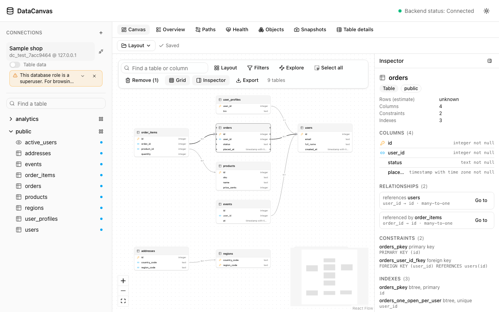
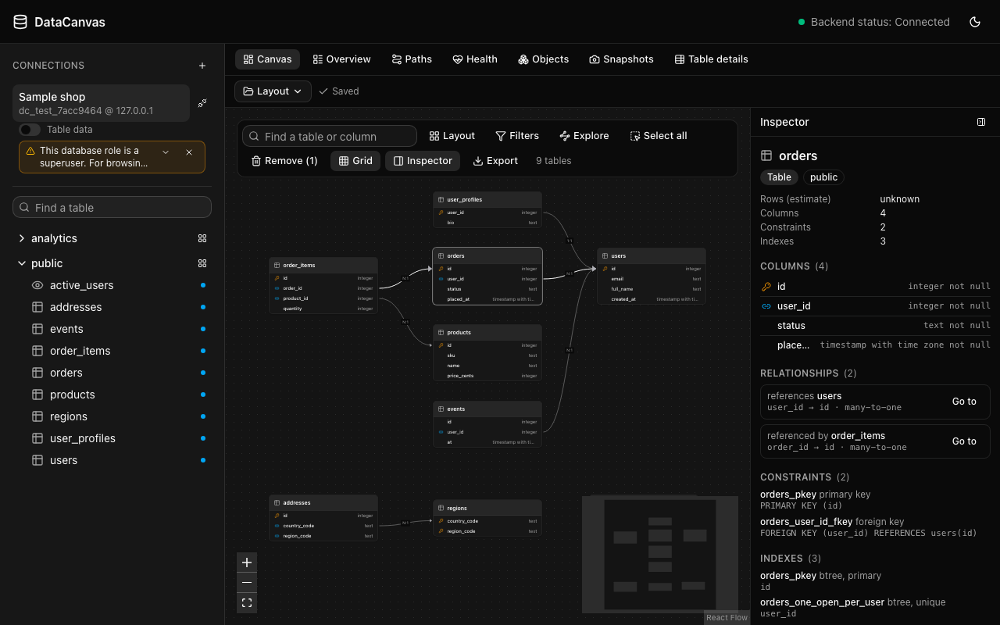

With a connection selected, the workspace offers these tabs: **Canvas, Overview, Paths, Health, Objects,
SQL, Snapshots, Migrations** and **Table details**. This page covers the Canvas; the others have their
own pages.

## Adding tables

- Click a table in the left list to put it on the canvas. A dot marks tables already there.
- The grid button beside a schema (**Add all tables of this schema**) adds the whole schema, up to
  **1,000 tables at once**.
- **Find a table** at the top of the left list narrows it to tables and views whose name contains what
  you type, across **every schema**, including ones you have not opened. The first search loads each
  schema's table list once. Matching is case-insensitive, `%` and `_` are ordinary characters, and
  **Escape** or the clear button restores the tree as it was. The text you type stays in your browser.
- The canvas search box adds one table or finds a column. Tables already on the canvas are matched in
  the browser; everything else is asked of the server.

## Relationships

Edges are drawn from **declared foreign keys only**. DataCanvas never guesses a relationship from
column names. Each edge shows its cardinality from the source table's point of view: `1:1` when the
foreign key columns are also unique, otherwise `N:1` (and `1:N` read the other way). Many-to-many
appears as two links through a junction table. Relationships across schemas are drawn too.

Edges are **never stored**; they are recomputed from the relationships and the tables present, so
adding or removing a table makes the right edges appear or vanish.

## Arranging

- Drag, zoom and pan on an infinite plane.
- **Layout** offers hierarchical, grouped (one layered layout per connected group, packed side by
  side), compact, or a plain grid. The layout engine (ELK) is loaded only when you use it.
- **Explore** can focus on the selected table and the tables within **1 to 5 relationships** of it,
  dimming or hiding the rest, in one or both directions.
- **Filters** hide schemas, views or relationship types.
- Large tables show at most 12 columns while collapsed.

## The inspector

Click a table to open the inspector: columns, relationships, constraints, indexes, and (if you have
allowed it) its rows. It reads from the cache the canvas already holds, so opening it makes no extra
request.

## Tables that no longer exist

A saved layout names tables, but the database may have changed. Tables that are gone come back as
dashed "no longer exists" cards at their saved positions, and a banner says how many. They are saved
again with the layout. A missing schema counts as missing tables. Any other failure (unreachable,
timeout) aborts the restore and leaves the canvas as it was.

## Saving and exporting

- Layouts are **autosaved** (800 ms after the last change) for connections that were saved. See
  [Saved data and themes](/guides/saved-data/).
- **Export** writes a **PNG or SVG** of the canvas. The image shows table and column names, so share
  it only with people who should see your schema. It contains no row data. A dark-mode export is dark.
- A workspace can also be exported as a `.datacanvas.json` file and imported again.

## Keyboard and accessibility

The data grid is a real `<table role="grid">` with one tab stop; arrow keys, Home, End and Page Up/Down
move between cells. `axe-core` is a root dev dependency, which suggests accessibility checks exist
in the browser tests (**Inference**; this documentation did not verify where or how much they cover).

---

**Sources:** [`apps/web/features/canvas/`](https://github.com/ShubhamTiwari909/pg-visualizer/tree/main/apps/web/features/canvas),
[`packages/canvas-engine/src/`](https://github.com/ShubhamTiwari909/pg-visualizer/tree/main/packages/canvas-engine/src),
[`apps/web/features/explorer/workspace.tsx`](https://github.com/ShubhamTiwari909/pg-visualizer/blob/main/apps/web/features/explorer/workspace.tsx),
[`docs/architecture.md`](https://github.com/ShubhamTiwari909/pg-visualizer/blob/main/docs/architecture.md) (Phases 7 to 9, sidebar search),
[`docs/getting-started.md`](https://github.com/ShubhamTiwari909/pg-visualizer/blob/main/docs/getting-started.md). The 1,000-table cap is `MAX_TABLES_ADDED_AT_ONCE` in `add-tables.ts`
(`docs/architecture.md` still says 200, which is out of date).
