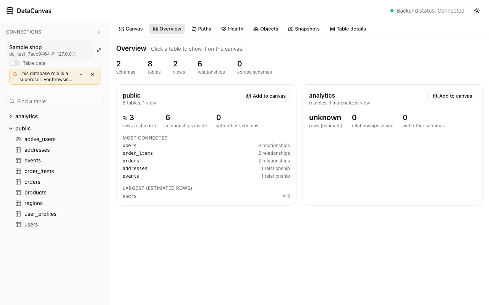
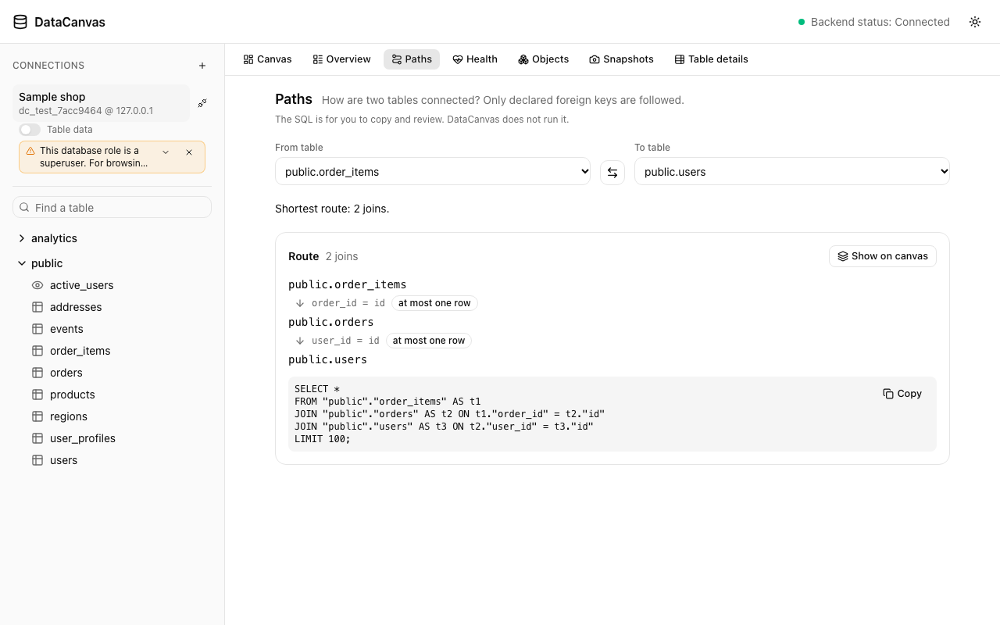
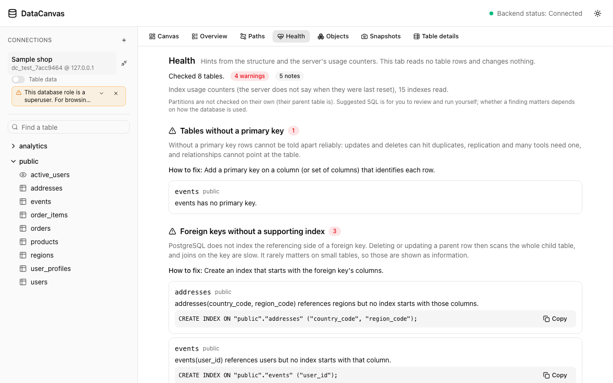

None of these tabs reads table rows. They combine metadata the app already loads.

## Overview

One card per schema shows:

- counts by kind (tables, views, materialized views, foreign tables) and summed row **estimates**;
- relationships inside the schema, going out and coming in, and which other schemas it connects to;
- the five most connected tables, the five largest, and tables with **no declared relationships**.

A table name is a button that puts the table on the canvas and switches to it. **Add to canvas** adds a
whole schema. "No relationships" means no _declared_ foreign key touches the table; views never have
foreign keys, so they are not listed as such.

The Overview also has an **Export documentation** button (1.10.0): the structure of the whole database or
one schema as a Markdown data dictionary or a Mermaid, DBML or PlantUML diagram, made in your browser from
names and types only. See [Export documentation](/guides/export-json-validate/#export-documentation-structure-only).

## Paths

Choose a start and an end table (a swap button reverses them). DataCanvas runs a breadth-first search
over declared foreign keys **in both directions** and shows the shortest chain, **every equally short
route up to five**, in a stable order. Several foreign keys between the same two tables count as
different routes.

Each step records its direction. Going from a child to its parent returns at most one row; going from a
parent to its children can return many, and the view says so. For each route you get the columns joined
at every step and a `SELECT * FROM … AS t1 JOIN … ON … LIMIT 100;` to **copy** (every name is quoted;
composite keys join on every column pair). **Show on canvas** adds the tables on the route. If no chain
of foreign keys connects the tables it says so; it never guesses from column names.

The generated SQL is text to copy. DataCanvas does not run it (use the [SQL tab](/guides/sql/)).

## Health

Structural checks over every table (up to **2,000 tables**), grouped by check with the reason, the fix,
a button per table to show it on the canvas, and SQL to copy. Warnings are open; notes are folded.
Treat findings as hints: only you know whether one matters for your database.

| Check                           | What it reports                                                                                                                                                                                                                                          |
| ------------------------------- | -------------------------------------------------------------------------------------------------------------------------------------------------------------------------------------------------------------------------------------------------------- |
| No primary key                  | Tables without one.                                                                                                                                                                                                                                      |
| Foreign key without an index    | An index whose leading columns (in any order) equal the foreign key's is a match; partial indexes and index types that cannot serve equality lookups do not count. Downgraded to a note for tables under 1,000 estimated rows.                           |
| Foreign key type mismatch       | Built-in types only. Different types (integer vs bigint, an array vs its element) are a warning with an `ALTER … TYPE`; a difference only in length or precision, or text vs varchar, is information. Domains, enums and extension types are not judged. |
| Duplicate and redundant indexes | Same method, uniqueness, key columns, predicate and INCLUDE; or a prefix of another index.                                                                                                                                                               |
| Unused indexes                  | From the server's own usage counters (`pg_stat_all_indexes.idx_scan`), never table rows. See below.                                                                                                                                                      |
| Nullable foreign keys           | Foreign key columns that allow NULL.                                                                                                                                                                                                                     |
| Naming                          | Names that need quoting, and single-column foreign keys not ending in `_id`, judged against **your database's own** majority style (at least 80%), never a fixed rule.                                                                                   |
| Very wide tables                | Over 50 columns.                                                                                                                                                                                                                                         |

### Unused indexes are cautious on purpose

"Zero scans" is easy to over-read. The check never lists an index that backs a primary key, unique or
exclusion constraint, a unique index, or an invalid one. It is a **warning** only when the index is at
least 10 MB, the counters are at least a week old (or of unknown age) and the server is not a standby;
otherwise it is information. When the index is the only one serving a foreign key it says so and offers
no `DROP`. The tab states when the counters started counting, and on a standby that they only reflect
queries run there. A zero means "not used since then, **on this server**": check every server that
answers queries before dropping anything. The suggestion is `DROP INDEX CONCURRENTLY`.

**Not covered:** plural vs singular names, naming of indexes and constraints, bloat and statistics,
unused tables, and index usage across several servers.

---

**Sources:** [`apps/web/features/overview/`](https://github.com/ShubhamTiwari909/datacanvas/tree/main/apps/web/features/overview),
[`apps/web/features/paths/path-finder.ts`](https://github.com/ShubhamTiwari909/datacanvas/blob/main/apps/web/features/paths/path-finder.ts),
[`apps/web/features/health/health-checks.ts`](https://github.com/ShubhamTiwari909/datacanvas/blob/main/apps/web/features/health/health-checks.ts),
[`docs/architecture.md`](https://github.com/ShubhamTiwari909/datacanvas/blob/main/docs/architecture.md) (Schema overview, Health checks, Path finder).
