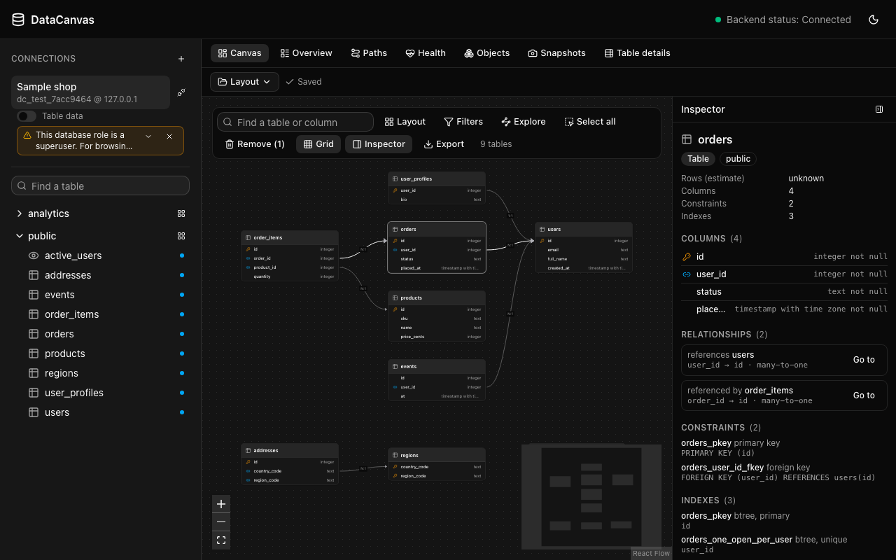

## The data folder

```text
~/.datacanvas/                  (DATACANVAS_HOME overrides; created owner-only)
├── connections.json            saved connection profiles
├── workspaces/<id>.json        one file per canvas layout
├── saved-queries/<profile-id>.json  saved SQL for a connection profile
├── snapshots/<id>.json         one file per structure snapshot
├── run.json                    port, token and pid of the running instance (deleted on exit)
└── mcp.json                    port, pid and the token of /mcp, for `datacanvas mcp` (1.11.0; mode 0600, deleted on exit)
```

Files are written with owner-only permissions (mode `0600`; the folder is `0700`). Each file records a
`format` and a `schemaVersion`. A file from a **newer** release is refused with a clear message instead of
being guessed at, and a damaged file is skipped (never deleted).

|                 | Saved connection profile                                                   | Workspace                                            |
| --------------- | -------------------------------------------------------------------------- | ---------------------------------------------------- |
| Holds           | name, host, port, database, user, SSL mode, and whether data viewing is on | table names, positions, expanded flags, pan and zoom |
| **Never** holds | **the password**                                                           | credentials, columns and types, selection            |
| Lives until     | you forget it                                                              | you delete it                                        |

The **password is never written to disk**; you enter it again after a restart. Explicitly [saved SQL queries](/guides/sql/#saved-queries) for a saved connection are kept in its
private library file and include any literals you typed. Temporary connections keep their libraries
in memory. SQL drafts, results, and execution history also stay in memory.

## Saved connections

Use **Save connection** (or tick it when connecting). Forgetting a profile also **deletes its
workspaces**; live connections opened from it are unlinked. Limits: 100 profiles, 500 workspaces, 100
snapshots.

## Workspaces and autosave

Layouts are saved **automatically** for connections linked to a saved profile (so the file can be found
after a restart): each change restarts an 800 ms timer, so a drag is one save, and selecting or measuring
never writes. For other connections the bar says the layout is not saved and offers **Save connection**.
Switching or creating a workspace flushes the current one first.

A **workspace can be exported** as `<name>.datacanvas.json` (the machine-specific profile link is removed)
and **imported** as a new workspace. Imports are validated and upgraded through the same versioned-file
path; unknown or oversize files are refused.

Why files and not browser storage: browser storage belongs to an origin including its port, so starting on
4748 instead of 4747 would silently hide everything. Files in the home folder do not depend on the port.

## What is kept in the browser only

The theme choice and table search text stay in your browser. **Saved filter templates** store columns
and operators. For a saved connection, they live in this browser's local storage, scoped to the
profile and table. For a temporary connection, they stay in memory until disconnect or reload. Data
rows, sorts, filter values, and write previews are never persisted.

## Themes

The sun or moon button in the top bar chooses **Light**, **Dark** or **System** (follow your operating
system, live). A small inline script in the page head applies the saved choice before first paint, so
there is no white flash. The canvas and image export follow the theme.



---

**Sources:** [`apps/web/lib/server/storage/`](https://github.com/ShubhamTiwari909/datacanvas/tree/main/apps/web/lib/server/storage),
[`apps/web/features/workspaces/`](https://github.com/ShubhamTiwari909/datacanvas/tree/main/apps/web/features/workspaces),
[`apps/web/lib/theme.ts`](https://github.com/ShubhamTiwari909/datacanvas/blob/main/apps/web/lib/theme.ts),
[`docs/architecture.md`](https://github.com/ShubhamTiwari909/datacanvas/blob/main/docs/architecture.md) (Phase 8, Theme),
[`SECURITY.md`](https://github.com/ShubhamTiwari909/datacanvas/blob/main/SECURITY.md). See also [Persistence](/architecture/persistence/).
