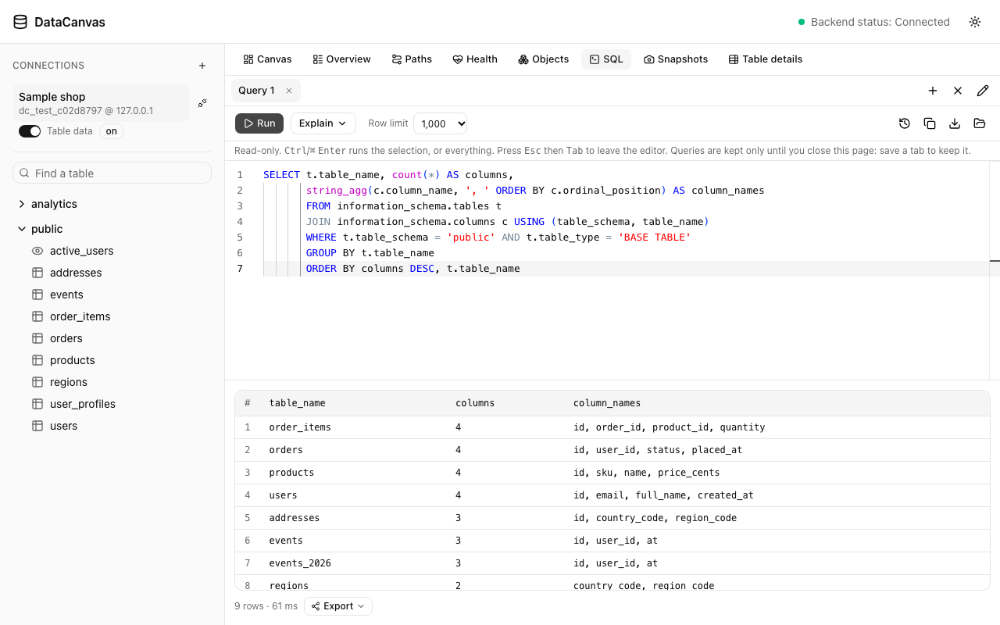

The **SQL** tab needs **Allow viewing table data** for the connection (a result is rows); until then it
says so and offers to switch it on. It **never changes your database**, even with `--enable-writes`.

## Running a statement

- Type a statement and press **Run** (or Ctrl/Cmd plus Enter). If some text is selected, only the
  selection runs. **Cancel** stops it in the database.
- Only statements that start with `SELECT`, `WITH`, `VALUES`, `TABLE`, `EXPLAIN` or `SHOW` are accepted,
  **one statement at a time**.
- Only one statement runs at a time per connection, whichever tab it is in (`sql_busy` otherwise).

## Completion

Suggests tables, views and schemas after `FROM` and `JOIN`; elsewhere the columns of the tables in your
statement (with their types), then aliases, functions and keywords; and a table's or alias's columns
after `alias.`. Press Ctrl/Cmd plus Space to open it. Names come from what the app already reads, kept in
memory. A button re-reads table and column names for a change made by another tool after the tab opened.
The editor (Monaco) is built into the package and loads nothing from another host.

## Query tabs and files

**+** opens a tab, double-click or the pencil renames it, the copy button duplicates it, **x** or Delete
closes it. Queries are **not kept** when you close the page: save a tab as a `.sql` file with the download
button, and open one with the folder button.

## Results

A table where NULL and an empty value look different and long values open in a dialog. The footer shows
the row count, the time taken, and when rows were left unread. **Row limit** is 100, 1,000 (default),
5,000 or 10,000. **Export** copies the rows as TSV, CSV or JSON or saves a CSV file; a value a
spreadsheet would run as a formula gets a leading apostrophe.

## Explain

**Explain** shows the plan of the statement. **Explain analyze** _runs_ the statement and shows real
times. Both work on a query only (an `EXPLAIN` containing `INTO` is refused, because PostgreSQL would run
`EXPLAIN ANALYZE CREATE TABLE … AS` without its read-only check).

## History

The clock button lists what ran on this connection since you opened the page, with how each went. Open
one in a new tab, run it again, copy it or clear the list. History is memory-only.

## Errors

The database's own sentence plus the line and column, with the place marked in the text.

## Limits

| Limit            | Value                                    |
| ---------------- | ---------------------------------------- |
| Statement length | 200,000 characters                       |
| Rows             | 1,000 by default, 10,000 at most         |
| Result size      | read in small batches, stopped at 64 MB  |
| Cell             | 2,000 characters kept                    |
| Time             | 30 seconds by default, 5 minutes at most |
| Lock wait        | 3 seconds                                |

A single very large value is still read whole before it is cut, so a statement that returns half a
gigabyte in one cell can use that much memory.

## Your role matters most

Hiding columns by name **does not apply** in this tab (a query can rename or compute any column), so
**the database role is the control**. A read-only transaction stops every write, but not what a function
can do outside the database. If your role is a superuser or may run programs or read files on the server,
a note appears above the editor saying so. Use a read-only role for SQL you did not write. A pooler such
as PgBouncer can make Cancel reach the wrong session; use a direct connection for SQL you may need to
cancel.

---

**Sources:** [`packages/database-core/src/sql-run.ts`](https://github.com/ShubhamTiwari909/pg-visualizer/blob/main/packages/database-core/src/sql-run.ts) (`SQL_LIMITS`, `ALLOWED_FIRST_WORDS`),
[`apps/web/lib/server/sql-service.ts`](https://github.com/ShubhamTiwari909/pg-visualizer/blob/main/apps/web/lib/server/sql-service.ts),
[`apps/web/features/sql/`](https://github.com/ShubhamTiwari909/pg-visualizer/tree/main/apps/web/features/sql),
[`SECURITY.md`](https://github.com/ShubhamTiwari909/pg-visualizer/blob/main/SECURITY.md) (The SQL tab),
[`docs/getting-started.md`](https://github.com/ShubhamTiwari909/pg-visualizer/blob/main/docs/getting-started.md) (section 6).
