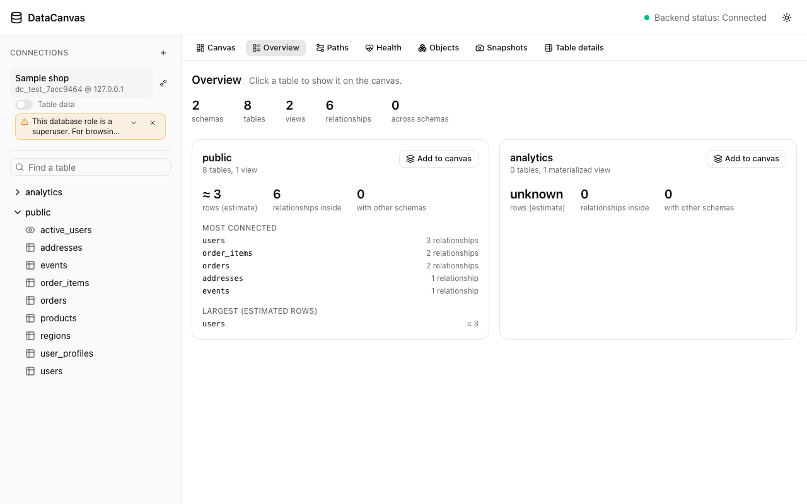

import { Card, CardGrid, LinkCard } from "@astrojs/starlight/components";

These pages document **DataCanvas 1.13.0**, the version in the repository's root `package.json` and
the top entry of its `CHANGELOG.md`. The package is published to npm as
`@shubhamtiwari909/datacanvas` and started with one command:

```bash
npx --yes @shubhamtiwari909/datacanvas
```

## What it does

<CardGrid>
  <Card title="Explore" icon="seti:db">
    Schemas, tables, views, columns, keys, indexes and relationships on an infinite canvas, plus an
    overview, a path finder between two tables, and a health check of the data model.
  </Card>
  <Card title="Look at data" icon="document">
    Optional, off by default: read-only pages of rows with sorting, up to ten filter conditions,
    export (also of the rows you chose, or as an INSERT script), a JSON editor and a database-side
    Validate. Statistics, a query plan tree and documentation files (Markdown, Mermaid, DBML,
    PlantUML) need no row at all.
  </Card>
  <Card title="Use it from Claude" icon="star">
    Optional, read-only, off until you share a connection: Claude Desktop or Claude Code can read
    the structure, or structure and data with your approval on every call. What Claude reads is sent
    to Anthropic by the Claude app.
  </Card>
  <Card title="Compare and migrate" icon="random">
    Snapshots of structure, a diff between any two sides, and generated migrations with rollback.
    DataCanvas writes the SQL text and never runs it.
  </Card>
  <Card title="Change data" icon="pencil">
    Optional and guarded by three independent switches: row edits, bulk changes, CSV import, and
    table design, each shown as the exact statement before it runs.
  </Card>
</CardGrid>

## Where to go next

<CardGrid>
  <LinkCard
    title="Installation"
    href="/start/installation/"
    description="Requirements, the one-line install, and what it prints."
  />
  <LinkCard
    title="User guides"
    href="/guides/canvas/"
    description="Every tab of the app, in the order you will use them."
  />
  <LinkCard
    title="Use DataCanvas from Claude"
    href="/guides/use-with-claude/"
    description="Share a connection read-only with a Claude app, with approval, Pause and a list of what it asked."
  />
  <LinkCard
    title="Security and privacy"
    href="/security/model/"
    description="What stays on your machine, what is read, and the known limits."
  />
  <LinkCard
    title="Architecture"
    href="/architecture/overview/"
    description="Packages, layers, the request path and the safety rules enforced by tests."
  />
  <LinkCard
    title="HTTP API reference"
    href="/reference/api/"
    description="Every route under /api and the /mcp door, with its method and purpose."
  />
  <LinkCard
    title="Contributing"
    href="/contributing/development/"
    description="Build from source, run the tests, and release."
  />
</CardGrid>

## About these docs

This site was generated from the repository's source, its `README.md`, `SECURITY.md`,
`CONTRIBUTING.md`, `CHANGELOG.md` and the long-form notes in `docs/`. Each page ends with a
**Sources** list pointing at the files it is based on. Statements marked **Inference** are
interpretation, and **Unknown** marks things the repository does not establish. The notes in `docs/`
(architecture, decisions, threat model, plans) stay the authoritative long form; this site organises
them by what a reader wants to do.


